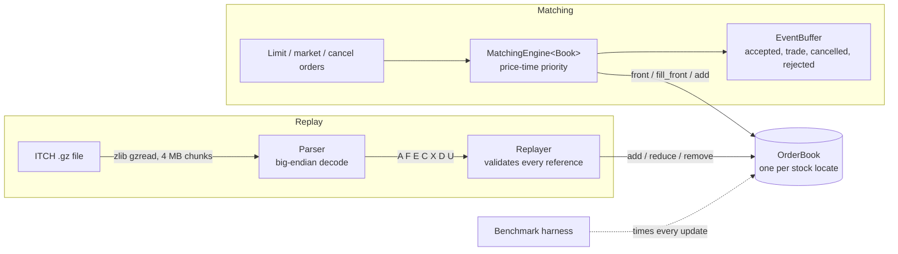
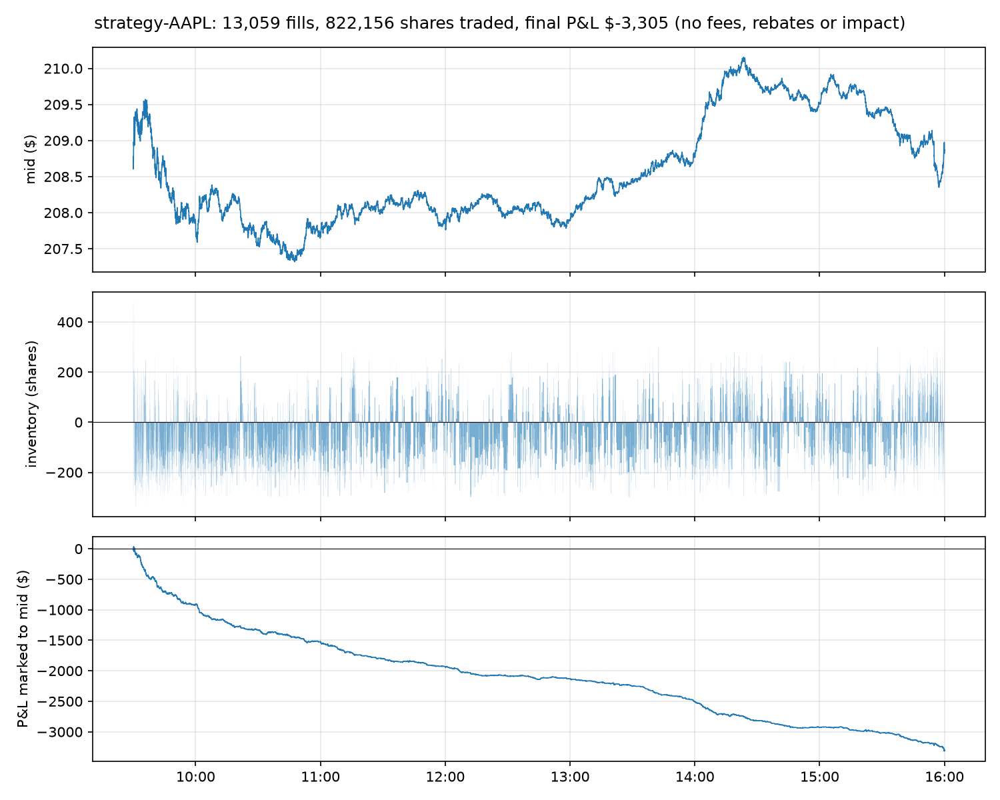

# Limit Order Book & Matching Engine

A C++20 limit order book and price-time priority matching engine, validated by
replaying NASDAQ TotalView-ITCH 5.0 market data and benchmarked as a latency
distribution, not an average.

The same book code runs two ways:

- **Matching mode**: new limit, market and cancel orders go in, and the engine decides the trades.
- **Replay mode**: ITCH events (add, execute, cancel, delete, replace) are applied directly. The
  exchange already did the matching, so replay checks that the book can follow a real
  trading day exactly.

## Status

- [x] Build, tests, sanitizers, CI
- [x] Correct matching engine with unit, randomized and differential tests
- [x] ITCH 5.0 parser and per-symbol replay: a full trading day replays with zero invalid references
- [x] Benchmark harness: throughput and p50/p90/p99/p99.9/max latency
- [x] Optimization rounds: four book implementations compared (Apple M3 numbers; Linux run pending)
- [x] Strategy simulator: market making against the replayed day with exact queue-position fills

## Architecture



`OrderBook` is a C++20 concept ([order_book.hpp](include/lob/order_book.hpp)).
`MatchingEngine<Book>`, the replayer and the benchmarks are all templates over it.
A new book implementation therefore plugs into every test and benchmark without
other changes.

## Design

**Prices are integers.** Prices are `int64_t` ticks, never `double`. ITCH prices already carry
four implied decimals ($123.45 is 1234500), so they are kept exactly as sent.

**Baseline book** ([map_order_book.hpp](include/lob/map_order_book.hpp)), written to be obviously correct:

| Need | Structure | Cost |
|---|---|---|
| Best price | `std::map` per side, ordered so `begin()` is best | O(1) best, O(log L) new level |
| Time priority | `std::list<Order>` FIFO per level | O(1) push / pop |
| Cancel by id | `std::unordered_map<OrderId, list iterator>` | O(1) average |

Each level also keeps a running total quantity, and an empty level is erased immediately.

**Matching rules** ([matching_engine.hpp](include/lob/matching_engine.hpp)):

- A buy limit at P trades against asks while the best ask is at or below P. A sell is the mirror image.
- Within a level, the oldest order fills first.
- Every trade executes at the resting order's price.
- The unfilled remainder of a limit order rests at its limit price.
- A market order trades until it is filled or the other side is empty. Any remainder is cancelled, never rested.
- Each operation appends events to a caller-owned buffer. After warm-up, steady-state operation does not allocate for events.

**ITCH replay** ([replay.hpp](include/lob/replay.hpp), [parser.hpp](include/lob/itch/parser.hpp)):

- Fields are read with `memcpy` plus `__builtin_bswap*`, which avoids unaligned-read UB.
- Stock locate codes index a vector of books directly, so ticker strings are never hashed.
- Every E, C, X and D must reference a live order with enough shares, and every violation is counted.
- `U` (replace) deletes the old id and adds a new id on the same side. The new order goes to the back of the queue.
- Adds and replaces that leave a book locked or crossed during market hours (between `S` events `Q` and `M`) are
  logged with the stock's trading state from its latest `H` message. A halted or paused stock may legitimately
  cross, because Nasdaq stops matching until the reopening auction. A stock that is trading must never cross.

## Build and test

Requires CMake 3.24+, Ninja, zlib, and GCC 13+ or Clang 17+. GoogleTest and Google Benchmark are fetched automatically.

```sh
cmake --preset debug   && cmake --build --preset debug   && ctest --preset debug    # ASan + UBSan
cmake --preset release && cmake --build --preset release && ctest --preset release  # -O3 -march=native
cmake --preset profile && cmake --build --preset profile                            # RelWithDebInfo for perf
```

Set `LOB_RANDOM_OPS=50000000` for a longer randomized soak run.

## Replaying a NASDAQ trading day

Sample files are on NASDAQ's public ITCH directory (`emi.nasdaq.com/ITCH/Nasdaq ITCH/`).
`07302019.NASDAQ_ITCH50.gz` is one of the smaller days, about 3.7 GB. Keep data in `data/`,
which is git-ignored, since the files are large and not ours to redistribute.

```sh
./build/release/lob_replay data/07302019.NASDAQ_ITCH50.gz --symbol AAPL --interval 60
```

The tool prints a top-of-book snapshot every interval, then message counts by type,
executions, invalid references, crossed books by trading state, and final depth. It exits
non-zero on any invalid reference, any malformed message, or any book that crosses while
its stock is trading. Add `--crossings-csv PATH` to dump every crossing.

### Validation: July 30, 2019

| | |
|---|---|
| Messages replayed | 282,229,684 (8.66 GB uncompressed) |
| Symbols | 8,849 |
| Orders added (`A` + `F`) | 125,460,750 |
| Executions against the book (`E` + `C`) | 7,717,995 (921,453,624 shares) |
| Invalid references (E/C/X/D/U on a missing order or too few shares) | **0** |
| Malformed messages | **0** |
| Books locked or crossed while the stock was trading | **0** |
| Books locked or crossed while halted or paused | 485, in 4 symbols (ARRY, SES, CCIH, BIQI) |

Sanity checks on AAPL:

- **Spread:** $0.01–0.02 through regular hours, wider before the open and after the close.
- **Close:** the quote at 16:00 was $208.85 / $208.89, matching the official close of about $208.8.
- **After hours:** the book moves to about $217. Apple reported earnings after the close that day.

All remaining orders are deleted after the post-market session, so every book is empty at the end of the file.

## Benchmarks

```sh
bench/run_bench.sh data/07302019.NASDAQ_ITCH50.gz   # or with no file: synthetic workloads only
```

Method:

- Release build, pinned to one core with `taskset` on Linux.
- Everything is decompressed into memory first, and parsing is timed separately from book updates.
- One warm-up pass, then 5 runs. Throughput is the median run, and the latency percentiles come
  from the run with the median p99.
- Every result records the CPU model, compiler, and measured timer overhead.

Plot a latency CSV with `python analysis/plot_latency.py results/<run>/latency.csv`.

### Optimization rounds

Each step is one change on top of the previous one
([pooled_order_book.hpp](include/lob/pooled_order_book.hpp)). All four books pass the same unit,
randomized and differential tests. All four replay the full July 30, 2019 day with identical
results: 7,717,995 executions, 0 invalid references.

ITCH replay: the book updates from the first 20M messages of the day (18.6M add / execute /
cancel / delete / replace operations), pre-decoded and held in memory:

| Book | Change | Mops/s | p50 ns | p90 ns | p99 ns | p99.9 ns |
|---|---|---:|---:|---:|---:|---:|
| `MapOrderBook` | baseline: `std::map` levels, `std::list` FIFO, `std::unordered_map` index | 5.27 | 125 | 423 | 959 | 1,631 |
| `PoolOrderBook` | orders in one pool with a free list; intrusive FIFO links | 6.67 | 85 | 375 | 927 | 1,599 |
| `PoolFlatOrderBook` | open-addressing hash index | 11.82 | 42 | 211 | 639 | 1,183 |
| `VectorOrderBook` | sorted-vector price levels, best price at the back | **17.17** | 42 | 125 | **375** | **751** |

Matching engine: 2M synthetic limit / market / cancel orders against a book of up to 10,000 resting
orders. Throughput went from 15.66 to 35.98 Mops/s, and p99 from 295 to 85 ns.

_Measured on an Apple M3 (clang 17, 3 runs plus a warm-up). Apple Silicon's `steady_clock` ticks
every ~42 ns, so p50 values are quantized; publishable numbers will come from a pinned Linux x86
run. Raw output: `results/m5-mac/` (not committed)._

**Why each step helped:**

- **Pooled orders and an intrusive FIFO** (+27%). Adding an order no longer allocates a
  `std::list` node, and deleting one no longer frees it. The day has 125M adds and 120M deletes.
  The gain is modest because the id index still allocates a node per entry.
- **Flat hash index** (+77%, the biggest step). Every execute, cancel, delete and replace
  starts with an id lookup. `std::unordered_map` loads the bucket array and then chases a
  pointer to a separately allocated node, often two cache misses. Linear probing in one flat
  array usually touches a single cache line, and inserts don't allocate. Fibonacci hashing
  spreads ITCH's near-sequential ids. Backward-shift deletion means no tombstones, so probe
  chains don't degrade over a 280M-message day.
- **Sorted-vector levels** (+45%). Activity clusters near the top of the book. With the best
  price at the back of a contiguous array, the best level is `back()`. Creating or removing a
  level near the top shifts only a few entries. Finding a price is a binary search over adjacent
  memory instead of a walk through red-black tree nodes scattered across the heap.

Net: 3.3x throughput on real market data, and p99 down from 959 to 375 ns.

## Strategy simulation

`lob_strategy` runs a simple market maker against one symbol of a replayed day
([strategy.hpp](include/lob/strategy.hpp)):

```sh
./build/release/lob_strategy data/07302019.NASDAQ_ITCH50.gz --symbol AAPL
python analysis/plot_strategy.py results/strategy-AAPL -o strategy.png
```

**Strategy.** Quote 100 shares one tick inside the spread, or join the best price when the
spread is under three ticks. Shift both quotes one tick against inventory per 200 shares held,
and stop quoting a side at ±1,000 shares. Quote only during regular hours, and only while the
stock is trading (not halted).

**Fill simulation.** Historical flow can't react to our orders, so they are tracked as shadow
orders beside the real book. Because ITCH is order-by-order data, queue position is **exact**,
not estimated. When a quote goes live, every order resting at its price is ahead of it, and
every later order is behind it. A quote fills when:

1. an order **behind** it at the same price executes (FIFO means we would have traded first),
2. an order at a **worse** price on our side executes (price priority), or
3. an opposite-side order arrives at a price that **reaches** our quote.

Executions, cancels, deletes and replaces of orders ahead of us move us up the queue. A replaced
order re-enters behind us. New quotes go live after a 20 µs entry latency, so one aggressive order
that prints as several executions can't fill us twice.

**AAPL, July 30, 2019, 9:30–16:00:**

| | |
|---|---|
| Quotes sent | 78,970 |
| Fill rate | 12.9% of quotes received a fill |
| Shares traded | 822,156 (13,059 fills) |
| Max \|inventory\| | 480 shares |
| Spread captured at fill | +0.51 ¢/share vs. mid |
| Mid move in the 1 s after a fill | −0.87 ¢/share |
| P&L marked to the closing mid | −$3,305 (−0.40 ¢/share) |



The strategy earns about half of AAPL's one-cent spread on every fill, then loses more than that
to **adverse selection**: the mid moves against it by 0.87¢ within a second. The orders that fill a
passive quote are disproportionately the informed ones. This is why real market makers depend on
exchange rebates, faster cancellation, and short-horizon price signals.

**Not modelled:** fees and rebates, market impact (our fills don't change the real flow), and
cancel latency (cancels are instant). This is a simulation exercise, not evidence of a profitable
(or unprofitable) strategy.

## Testing

- **Unit tests** cover each matching rule: resting, full and partial fills, multi-level sweeps,
  FIFO within a level, trades at the resting price, cancels from the middle of a queue,
  unknown and duplicate ids, and market orders into an empty side. Other unit tests cover
  ITCH decoding, chunked gzip streaming, replay semantics, and the histogram.
- **Randomized invariants:** 1M seeded operations. After every operation the book must be
  uncrossed, every level total must equal the sum of its orders, no level may be empty,
  FIFO sequence must be preserved, and the index must match the resting orders.
- **Differential testing:** the engine runs side by side with a deliberately naive reference
  ([reference_engine.hpp](tests/reference_engine.hpp)) that keeps one flat vector and does a
  linear scan per fill. Over four order-flow profiles, the two must emit identical event
  streams and agree on top of book after every operation. This is the safety net for optimization.
- **CI** builds with GCC 13 and Clang 18 under ASan and UBSan with `-Werror` on every push,
  plus a Release build and a benchmark smoke run.

## Repository layout

```
include/lob/         types, events, OrderBook concept, MapOrderBook, MatchingEngine, replay, histogram
include/lob/itch/    ITCH 5.0 messages, parser, gzip streaming, encoder (tests and synthetic data)
src/                 non-template implementations
tests/               GoogleTest unit, randomized and differential tests
bench/               Google Benchmark microbenchmarks, latency harness, run script
tools/               lob_replay and lob_strategy CLIs
docs/                charts referenced by this README
analysis/            latency plotting
```

## Adding a book implementation

`lob_replay --book map|pool|pool-flat|vector` replays a file with any implementation.

1. Write a class that satisfies `lob::OrderBook`, e.g. `include/lob/pool_order_book.hpp`, and
   `static_assert(OrderBook<PoolOrderBook>)`.
2. Instantiate the differential test and the `MapOrderBook` unit tests for it. It must pass before it is benchmarked.
3. Add `BENCHMARK_TEMPLATE(..., PoolOrderBook)` lines to [bench_book.cpp](bench/bench_book.cpp) and a
   workload to [latency_main.cpp](bench/latency_main.cpp).
4. Keep the change only if the numbers improve. Record the results in the table above.
