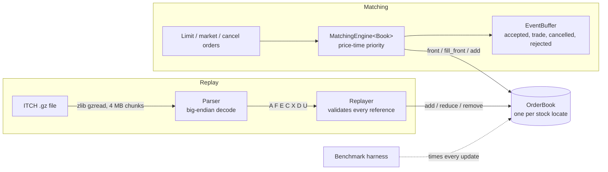
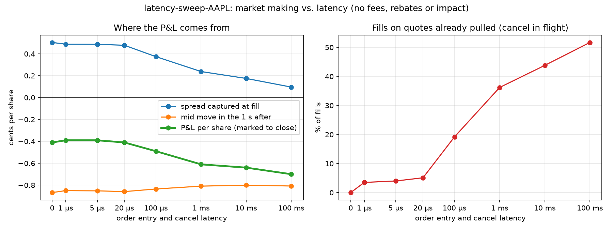

# Limit Order Book & Matching Engine

A C++20 limit order book and price-time priority matching engine, validated by
replaying NASDAQ TotalView-ITCH 5.0 market data and benchmarked as a latency
distribution, not an average.

The same book code runs two ways:

- **Matching mode**: new limit, market and cancel orders go in, and the engine decides the trades.
- **Replay mode**: ITCH events (add, execute, cancel, delete, replace) are applied directly. The
  exchange already did the matching, so replay checks that the book can follow a real
  trading day exactly.

**Highlights**

- **Validated on real market data:** replays a full NASDAQ trading day (282M messages, 8,849
  symbols) with zero invalid order references, and no book crosses during market hours while its
  stock is trading.
- **Measured optimization:** four book implementations, each one change on top of the last. The
  final book does **2.1x the baseline throughput** on real ITCH data (6.3 to 13.5M updates/s,
  Intel Xeon) and cuts **p99 latency by 47%** (847 to 447 ns).
- **Tested seriously:** 164 tests. Every book runs the same unit, randomized-invariant and
  differential tests against a naive reference engine. CI runs everything under AddressSanitizer
  and UBSan on GCC and Clang.
- **Strategy simulation:** a market maker with exact queue-position fills from order-level data,
  and a latency sweep showing how order and cancel speed drive adverse selection.

## Status

- [x] Build, tests, sanitizers, CI
- [x] Correct matching engine with unit, randomized and differential tests
- [x] ITCH 5.0 parser and per-symbol replay: a full trading day replays with zero invalid references
- [x] Benchmark harness: throughput and p50/p90/p99/p99.9/max latency
- [x] Optimization rounds: four book implementations compared on Linux x86 and Apple M3
- [x] Strategy simulator: market making against the replayed day with exact queue-position fills

## Architecture



`OrderBook` is a C++20 concept ([order_book.hpp](include/lob/order_book.hpp)).
`MatchingEngine<Book>`, the replayer and the benchmarks are all templates over it.
A new book implementation therefore plugs into every test and benchmark without
other changes.

## Design

**Prices are integers.** Prices are `int64_t` ticks, never `double`. ITCH prices already carry
four implied decimals ($123.45 is 1234500), so they are kept exactly as sent.

**Baseline book** ([map_order_book.hpp](include/lob/map_order_book.hpp)), written to be obviously correct:

| Need | Structure | Cost |
|---|---|---|
| Best price | `std::map` per side, ordered so `begin()` is best | O(1) best, O(log L) new level |
| Time priority | `std::list<Order>` FIFO per level | O(1) push / pop |
| Cancel by id | `std::unordered_map<OrderId, list iterator>` | O(1) average |

Each level also keeps a running total quantity, and an empty level is erased immediately.

**Matching rules** ([matching_engine.hpp](include/lob/matching_engine.hpp)):

- A buy limit at P trades against asks while the best ask is at or below P. A sell is the mirror image.
- Within a level, the oldest order fills first.
- Every trade executes at the resting order's price.
- The unfilled remainder of a limit order rests at its limit price.
- A market order trades until it is filled or the other side is empty. Any remainder is cancelled, never rested.
- Each operation appends events to a caller-owned buffer. After warm-up, steady-state operation does not allocate for events.

**ITCH replay** ([replay.hpp](include/lob/replay.hpp), [parser.hpp](include/lob/itch/parser.hpp)):

- Fields are read with `memcpy` plus `__builtin_bswap*`, which avoids unaligned-read UB.
- Stock locate codes index a vector of books directly, so ticker strings are never hashed.
- Every E, C, X and D must reference a live order with enough shares, and every violation is counted.
- `U` (replace) deletes the old id and adds a new id on the same side. The new order goes to the back of the queue.
- Adds and replaces that leave a book locked or crossed during market hours (between `S` events `Q` and `M`) are
  logged with the stock's trading state from its latest `H` message. A halted or paused stock may legitimately
  cross, because Nasdaq stops matching until the reopening auction. A stock that is trading must never cross.

## Build and test

Requires CMake 3.24+, Ninja, zlib, and GCC 13+ or Clang 17+. GoogleTest and Google Benchmark are fetched automatically.

```sh
cmake --preset debug   && cmake --build --preset debug   && ctest --preset debug    # ASan + UBSan
cmake --preset release && cmake --build --preset release && ctest --preset release  # -O3 -march=native
cmake --preset profile && cmake --build --preset profile                            # RelWithDebInfo for perf
```

Set `LOB_RANDOM_OPS=50000000` for a longer randomized soak run.

## Replaying a NASDAQ trading day

Sample files are on NASDAQ's public ITCH directory (`emi.nasdaq.com/ITCH/Nasdaq ITCH/`).
`07302019.NASDAQ_ITCH50.gz` is one of the smaller days, about 3.7 GB. Keep data in `data/`,
which is git-ignored, since the files are large and not ours to redistribute.

```sh
./build/release/lob_replay data/07302019.NASDAQ_ITCH50.gz --symbol AAPL --interval 60
```

The tool prints a top-of-book snapshot every interval, then message counts by type,
executions, invalid references, crossed books by trading state, and final depth. It exits
non-zero on any invalid reference, any malformed message, or any book that crosses while
its stock is trading. Add `--crossings-csv PATH` to dump every crossing.

### Validation: July 30, 2019

| | |
|---|---|
| Messages replayed | 282,229,684 (8.66 GB uncompressed) |
| Symbols | 8,849 |
| Orders added (`A` + `F`) | 125,460,750 |
| Executions against the book (`E` + `C`) | 7,717,995 (921,453,624 shares) |
| Invalid references (E/C/X/D/U on a missing order or too few shares) | **0** |
| Malformed messages | **0** |
| Books locked or crossed while the stock was trading | **0** |
| Books locked or crossed while halted or paused | 485, in 4 symbols (ARRY, SES, CCIH, BIQI) |

Sanity checks on AAPL:

- **Spread:** $0.01–0.02 through regular hours, wider before the open and after the close.
- **Close:** the quote at 16:00 was $208.85 / $208.89, matching the official close of about $208.8.
- **After hours:** the book moves to about $217. Apple reported earnings after the close that day.

All remaining orders are deleted after the post-market session, so every book is empty at the end of the file.

## Benchmarks

```sh
bench/run_bench.sh data/07302019.NASDAQ_ITCH50.gz   # or with no file: synthetic workloads only
```

Method:

- Release build, pinned to one core with `taskset` on Linux.
- Everything is decompressed into memory first, and parsing is timed separately from book updates.
- One warm-up pass, then 5 runs. Throughput is the median run, and the latency percentiles come
  from the run with the median p99.
- Every result records the CPU model, compiler, and measured timer overhead.

Plot a latency CSV with `python analysis/plot_latency.py results/<run>/latency.csv`.

### Optimization rounds

Each step is one change on top of the previous one
([pooled_order_book.hpp](include/lob/pooled_order_book.hpp)). All four books pass the same unit,
randomized and differential tests. All four replay the full July 30, 2019 day with identical
results: 7,717,995 executions, 0 invalid references.

**ITCH replay.** These are the book updates from the first 20M messages of the day: 18.6M
add / execute / cancel / delete / replace operations, pre-decoded and held in memory. Measured on
an Intel Xeon 6973P-C (Azure D2s_v7, Ubuntu 24.04, GCC 13.3, `-O3 -march=native`), pinned to one
core, with 5 runs plus a warm-up:

| Book | Change | Mops/s | p50 ns | p90 ns | p99 ns | p99.9 ns |
|---|---|---:|---:|---:|---:|---:|
| `MapOrderBook` | baseline: `std::map` levels, `std::list` FIFO, `std::unordered_map` index | 6.34 | 117 | 439 | 847 | 1,663 |
| `PoolOrderBook` | orders in one pool with a free list; intrusive FIFO links | 6.81 | 119 | 423 | 783 | 1,631 |
| `PoolFlatOrderBook` | open-addressing hash index | 9.36 | 89 | 351 | 671 | 1,247 |
| `VectorOrderBook` | sorted-vector price levels, best price at the back | **13.48** | **69** | **227** | **447** | **975** |

**Net: 2.1x throughput on real market data. p99 is down 47% (847 to 447 ns) and p99.9 is down
41%.** Latencies include the timer's own overhead, 16 ns at p50 (`steady_clock`, measured each run).

**Matching engine.** 5M synthetic limit / market / cancel orders against a book of up to 10,000
resting orders:

| Book | Mops/s | p50 ns | p99 ns | p99.9 ns |
|---|---:|---:|---:|---:|
| `MapOrderBook` | 19.03 | 65 | 239 | 343 |
| `PoolOrderBook` | 17.68 | 65 | 279 | 391 |
| `PoolFlatOrderBook` | 21.44 | 55 | 235 | 335 |
| `VectorOrderBook` | **29.85** | **50** | **139** | **195** |

**Second machine (Apple M3, clang 17).** The same ITCH workload went from 5.27 to 17.17 Mops/s
(3.3x), and p99 from 959 to 375 ns. The order of the four books is the same on both machines. The
M3's `steady_clock` ticks every ~42 ns, so its latency percentiles are coarse.

Raw output (`results/`, not committed) includes Google Benchmark microbenchmarks with 5 repetitions;
their coefficient of variation is under 1%.

**Why each step helped, or didn't:**

- **Pooled orders and an intrusive FIFO** (+7% on ITCH, neutral on matching). Adding an order no
  longer allocates a `std::list` node, and deleting one no longer frees it: +30% in the pure
  add/cancel microbenchmark. The gain on real data is small because the `std::unordered_map`
  index still allocates and chases a pointer on every operation, and that dominates. The step is
  kept because the next two depend on it: 32-bit pool indices are what the flat index stores and
  what the price levels point to.
- **Flat hash index** (+37%). Every execute, cancel, delete and replace starts with an id lookup.
  `std::unordered_map` loads the bucket array and then follows a pointer to a separately allocated
  node, often two cache misses. Linear probing in one flat array usually touches a single cache
  line, and inserts don't allocate. Fibonacci hashing spreads ITCH's near-sequential ids.
  Backward-shift deletion means no tombstones, so probe chains don't degrade over a
  280M-message day.
- **Sorted-vector levels** (+44% on ITCH, +39% on matching). The best price sits at the back of a
  contiguous array, so reaching it is `back()`. Creating or removing a level near the top shifts
  only a few entries. Finding a price is a binary search over adjacent memory instead of a walk
  through tree nodes scattered across the heap. This choice depends on the data. In the synthetic
  replay microbenchmark, which spreads orders evenly over 50 price levels, the vector book is
  *slower* than the tree (29.7 vs 33.6 M ops/s), because inserts land mid-array. Real order flow
  clusters at the top of the book, which is the case the layout is built for. That is why the real
  ITCH day is the benchmark that decides.

## Strategy simulation

`lob_strategy` runs a simple market maker against one symbol of a replayed day
([strategy.hpp](include/lob/strategy.hpp)):

```sh
./build/release/lob_strategy data/07302019.NASDAQ_ITCH50.gz --symbol AAPL
python analysis/plot_strategy.py results/strategy-AAPL -o strategy.png
```

**Strategy.** Quote 100 shares one tick inside the spread, or join the best price when the
spread is under three ticks. Shift both quotes one tick against inventory per 200 shares held,
and stop quoting a side at ±1,000 shares. Quote only during regular hours, and only while the
stock is trading (not halted).

**Fill simulation.** Historical flow can't react to our orders, so they are tracked as shadow
orders beside the real book. Because ITCH is order-by-order data, queue position is **exact**,
not estimated. When a quote goes live, every order resting at its price is ahead of it, and
every later order is behind it. A quote fills when:

1. an order **behind** it at the same price executes (FIFO means we would have traded first),
2. an order at a **worse** price on our side executes (price priority), or
3. an opposite-side order arrives at a price that **reaches** our quote.

Executions, cancels, deletes and replaces of orders ahead of us move us up the queue. A replaced
order re-enters behind us.

**Latency applies both ways.** A new quote is live only once it reaches the exchange, 20 µs
after it is sent by default. A quote we decide to pull **can still be filled** until our cancel
arrives, 20 µs later. So a side can briefly have two quotes at the exchange: the one being cancelled
and its replacement. Entry latency also stops one aggressive order that prints as several
executions from filling a refilled quote twice.

**AAPL, July 30, 2019, 9:30–16:00 (20 µs latency):**

| | |
|---|---|
| Quotes sent | 79,565 |
| Fill rate | 14.4% of quotes received a fill |
| Shares traded | 942,601 (15,114 fills) |
| Fills on quotes already pulled | 5.1% |
| Max \|inventory\| | 726 shares |
| Spread captured at fill | +0.48 ¢/share vs. mid |
| Mid move in the 1 s after a fill | −0.86 ¢/share |
| P&L marked to the closing mid | −$3,878 (−0.41 ¢/share) |


The strategy earns about half of AAPL's one-cent spread on every fill, then loses more than that
to **adverse selection**: the mid moves against it by 0.86¢ within a second. The orders that fill a
passive quote are disproportionately the informed ones. This is why real market makers depend on
exchange rebates, speed, and short-horizon price signals.

### How latency changes the result

The same strategy and day, run at every latency from an idealized 0 to a slow 100 ms
(`analysis/latency_sweep.sh`, plotted with `analysis/plot_latency_sweep.py`):

| Latency | Fills on pulled quotes | Spread captured | Mid move after fill | P&L per share | P&L |
|---:|---:|---:|---:|---:|---:|
| 0 | 0% | +0.50¢ | −0.87¢ | −0.41¢ | −$3,845 |
| 1 µs | 3.5% | +0.49¢ | −0.85¢ | −0.39¢ | −$3,681 |
| 20 µs | 5.1% | +0.48¢ | −0.86¢ | −0.41¢ | −$3,878 |
| 100 µs | 19.2% | +0.37¢ | −0.84¢ | −0.49¢ | −$4,621 |
| 1 ms | 36.2% | +0.24¢ | −0.81¢ | −0.61¢ | −$6,623 |
| 10 ms | 43.8% | +0.18¢ | −0.80¢ | −0.64¢ | −$6,900 |
| 100 ms | 51.7% | +0.10¢ | −0.81¢ | −0.70¢ | −$7,249 |



A slow market maker sees the price move and pulls its quote, but its cancel is still in flight when
faster traders hit the stale price. At 100 ms over half its fills come that way. Those fills happen
**after** the price has already moved, so the damage shows up as the spread captured collapsing
(+0.50¢ to +0.10¢), not as a larger move afterwards. The loss per share grows by 70%. Below about
20 µs the curve is flat: on this data, a few microseconds rarely decides whether a cancel lands in
time. In real markets that range is fought over by firms racing each other, and this simulation
has no competitors.

**Not modelled:** fees and rebates, market impact (our fills don't change the real flow), and
other traders reacting to our quotes. This is a simulation exercise, not evidence of a profitable
(or unprofitable) strategy.

## Testing

164 tests ([tests/](tests/)), run on every push under ASan and UBSan with GCC 13 and Clang 18.

- **Every book, same tests.** The book and matching-engine tests are typed tests
  ([book_types.hpp](tests/book_types.hpp)), so all four implementations must pass each one.
- **Matching rules:** resting, full and partial fills, multi-level sweeps, FIFO within a level,
  trades at the resting price, cancels from the middle of a queue, unknown and duplicate ids,
  and market orders into an empty side.
- **Randomized invariants:** 1M seeded operations per book. After every operation the book must
  be uncrossed, every level total must equal the sum of its orders, no level may be empty, FIFO
  sequence must be preserved, and the index must match the resting orders.
- **Differential testing against a reference engine.** Every book runs side by side with a
  deliberately naive reference ([reference_engine.hpp](tests/reference_engine.hpp)): one flat
  vector and a linear scan per fill. Over four order-flow profiles, they must emit identical event
  streams and agree on top of book after every operation.
- **Differential testing against the baseline book.** ITCH-style add / execute / cancel / delete /
  replace streams, with 1% corrupted to force rejections, must give the same results and the same
  book in every implementation.
- **Data structures:** the flat hash index is checked against `std::unordered_map` over 500k
  operations on a small key space, which forces probe-chain wraparound and backward shifts.
- **ITCH and replay:** message decoding, chunked gzip streaming, replace semantics, invalid
  references, and halt-aware crossing detection.
- **Strategy simulator:** each fill rule, exact queue position, entry and cancel latency, and
  P&L marked to the closing mid.
- **Real data:** all four books replay the full July 30, 2019 day with identical results (macOS),
  and the final book does the same on Linux.

The randomized tests were checked by planting bugs on purpose, such as trading at the incoming
price or a broken hash-table deletion. Each one was caught.

## Repository layout

```
include/lob/         types, events, OrderBook concept, the four books (map_order_book,
                     pooled_order_book + level_store + order_index), MatchingEngine,
                     replay, strategy simulator, latency histogram
include/lob/itch/    ITCH 5.0 messages, parser, gzip streaming, encoder (tests and synthetic data)
src/                 non-template implementations
tests/               GoogleTest unit, typed, randomized and differential tests
bench/               Google Benchmark microbenchmarks, latency harness, run script
tools/               lob_replay and lob_strategy CLIs
analysis/            latency, strategy and latency-sweep plots; sweep script
docs/                charts referenced by this README
```

## Adding a book implementation

1. Write a class that satisfies the `lob::OrderBook` concept, plus `depth_at`, `levels` and
   `validate`. Add `static_assert(OrderBook<MyOrderBook>)`.
2. Add it to `AllBooks` in [book_types.hpp](tests/book_types.hpp), which runs every typed test
   against it, and to the `Differential` test in [test_randomized.cpp](tests/test_randomized.cpp).
   It must pass before it is benchmarked.
3. Add a `LOB_BOOK_BENCHMARKS(MyOrderBook)` line to [bench_book.cpp](bench/bench_book.cpp), a
   `measure_book<MyOrderBook>` line to [latency_main.cpp](bench/latency_main.cpp), and a
   `--book` option to [replay_main.cpp](tools/replay_main.cpp).
4. Replay the full day with `--book` and confirm identical results. Run `bench/run_bench.sh`, and
   keep the change only if the numbers improve.
