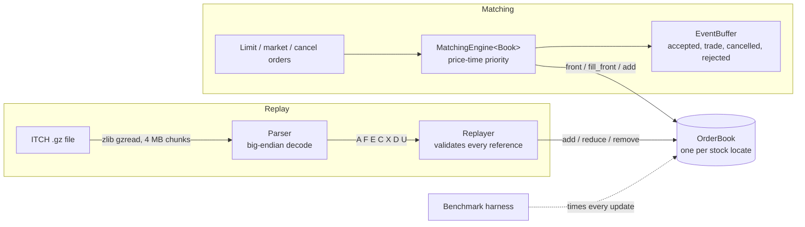

# Limit Order Book & Matching Engine

A C++20 limit order book and price-time priority matching engine, validated by
replaying NASDAQ TotalView-ITCH 5.0 market data and benchmarked as a latency
distribution, not an average.

The same book code runs two ways:

- **Matching mode**: new limit, market and cancel orders go in, and the engine decides the trades.
- **Replay mode**: ITCH events (add, execute, cancel, delete, replace) are applied directly. The
  exchange already did the matching, so replay checks that the book can follow a real
  trading day exactly.

## Status

- [x] Build, tests, sanitizers, CI
- [x] Correct matching engine with unit, randomized and differential tests
- [x] ITCH 5.0 parser and per-symbol replay with validation (tested on synthetic data; full-day run pending)
- [x] Benchmark harness: throughput and p50/p90/p99/p99.9/max latency
- [ ] Optimization rounds: at least three book implementations compared
- [ ] Strategy simulator (stretch)

## Architecture



`OrderBook` is a C++20 concept ([order_book.hpp](include/lob/order_book.hpp)).
`MatchingEngine<Book>`, the replayer and the benchmarks are all templates over it.
A new book implementation therefore plugs into every test and benchmark without
other changes.

## Design

**Prices are integers.** Prices are `int64_t` ticks, never `double`. ITCH prices already carry
four implied decimals ($123.45 is 1234500), so they are kept exactly as sent.

**Baseline book** ([map_order_book.hpp](include/lob/map_order_book.hpp)), written to be obviously correct:

| Need | Structure | Cost |
|---|---|---|
| Best price | `std::map` per side, ordered so `begin()` is best | O(1) best, O(log L) new level |
| Time priority | `std::list<Order>` FIFO per level | O(1) push / pop |
| Cancel by id | `std::unordered_map<OrderId, list iterator>` | O(1) average |

Each level also keeps a running total quantity, and an empty level is erased immediately.

**Matching rules** ([matching_engine.hpp](include/lob/matching_engine.hpp)):

- A buy limit at P trades against asks while the best ask is at or below P. A sell is the mirror image.
- Within a level, the oldest order fills first.
- Every trade executes at the resting order's price.
- The unfilled remainder of a limit order rests at its limit price.
- A market order trades until it is filled or the other side is empty. Any remainder is cancelled, never rested.
- Each operation appends events to a caller-owned buffer. After warm-up, steady-state operation does not allocate for events.

**ITCH replay** ([replay.hpp](include/lob/replay.hpp), [parser.hpp](include/lob/itch/parser.hpp)):

- Fields are read with `memcpy` plus `__builtin_bswap*`, which avoids unaligned-read UB.
- Stock locate codes index a vector of books directly, so ticker strings are never hashed.
- Every E, C, X and D must reference a live order with enough shares, and every violation is counted.
- `U` (replace) deletes the old id and adds a new id on the same side. The new order goes to the back of the queue.
- Adds and replaces that leave a book locked or crossed during market hours (between `S` events `Q` and `M`) are counted.

## Build and test

Requires CMake 3.24+, Ninja, zlib, and GCC 13+ or Clang 17+. GoogleTest and Google Benchmark are fetched automatically.

```sh
cmake --preset debug   && cmake --build --preset debug   && ctest --preset debug    # ASan + UBSan
cmake --preset release && cmake --build --preset release && ctest --preset release  # -O3 -march=native
cmake --preset profile && cmake --build --preset profile                            # RelWithDebInfo for perf
```

Set `LOB_RANDOM_OPS=50000000` for a longer randomized soak run.

## Replaying a NASDAQ trading day

Sample files are on NASDAQ's public ITCH directory (`emi.nasdaq.com/ITCH/Nasdaq ITCH/`).
`07302019.NASDAQ_ITCH50.gz` is one of the smaller days, about 3.7 GB. Keep data in `data/`,
which is git-ignored, since the files are large and not ours to redistribute.

```sh
./build/release/lob_replay data/07302019.NASDAQ_ITCH50.gz --symbol AAPL --interval 60
```

The tool prints a top-of-book snapshot every interval, then message counts by type,
executions, invalid references, crossed-book count, and final depth. It exits non-zero
if any reference was invalid or any message was malformed.

## Benchmarks

```sh
bench/run_bench.sh data/07302019.NASDAQ_ITCH50.gz   # or with no file: synthetic workloads only
```

Method:

- Release build, pinned to one core with `taskset` on Linux.
- Everything is decompressed into memory first, and parsing is timed separately from book updates.
- One warm-up pass, then 5 runs. Throughput is the median run, and the latency percentiles come
  from the run with the median p99.
- Every result records the CPU model, compiler, and measured timer overhead.

Plot a latency CSV with `python analysis/plot_latency.py results/<run>/latency.csv`.

| Implementation | Workload | Mops/s | p50 | p99 | p99.9 | CPU |
|---|---|---|---|---|---|---|
| `MapOrderBook` (baseline) | itch-replay | _TBD_ | | | | |

_Numbers are pending a run on a quiet Linux machine. On Apple Silicon `steady_clock` ticks every
~42 ns, which is too coarse for per-operation latency._

## Testing

- **Unit tests** cover each matching rule: resting, full and partial fills, multi-level sweeps,
  FIFO within a level, trades at the resting price, cancels from the middle of a queue,
  unknown and duplicate ids, and market orders into an empty side. Other unit tests cover
  ITCH decoding, chunked gzip streaming, replay semantics, and the histogram.
- **Randomized invariants:** 1M seeded operations. After every operation the book must be
  uncrossed, every level total must equal the sum of its orders, no level may be empty,
  FIFO sequence must be preserved, and the index must match the resting orders.
- **Differential testing:** the engine runs side by side with a deliberately naive reference
  ([reference_engine.hpp](tests/reference_engine.hpp)) that keeps one flat vector and does a
  linear scan per fill. Over four order-flow profiles, the two must emit identical event
  streams and agree on top of book after every operation. This is the safety net for optimization.
- **CI** builds with GCC 13 and Clang 18 under ASan and UBSan with `-Werror` on every push,
  plus a Release build and a benchmark smoke run.

## Repository layout

```
include/lob/         types, events, OrderBook concept, MapOrderBook, MatchingEngine, replay, histogram
include/lob/itch/    ITCH 5.0 messages, parser, gzip streaming, encoder (tests and synthetic data)
src/                 non-template implementations
tests/               GoogleTest unit, randomized and differential tests
bench/               Google Benchmark microbenchmarks, latency harness, run script
tools/               lob_replay CLI
analysis/            latency plotting
```

## Adding a book implementation

1. Write a class that satisfies `lob::OrderBook`, e.g. `include/lob/pool_order_book.hpp`, and
   `static_assert(OrderBook<PoolOrderBook>)`.
2. Instantiate the differential test and the `MapOrderBook` unit tests for it. It must pass before it is benchmarked.
3. Add `BENCHMARK_TEMPLATE(..., PoolOrderBook)` lines to [bench_book.cpp](bench/bench_book.cpp) and a
   workload to [latency_main.cpp](bench/latency_main.cpp).
4. Keep the change only if the numbers improve. Record the results in the table above.
